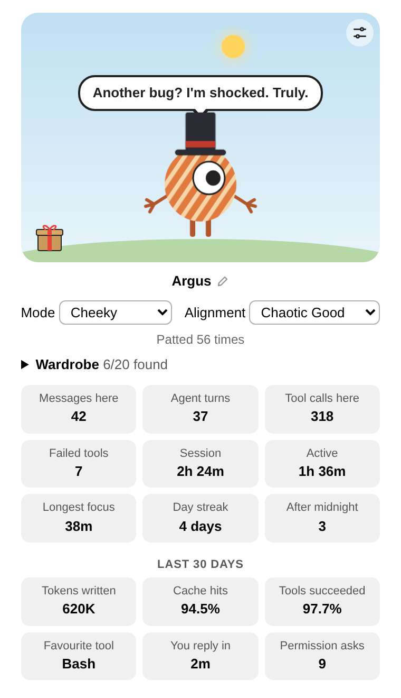
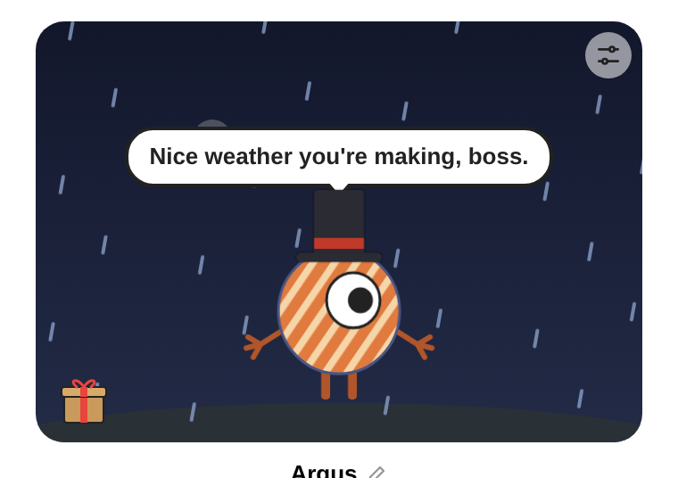

# Argus

A small pet for [Mirador](https://github.com/sodre90/mirador). Argus lives in the tab beside the canvas, reacts to how your work is going, tracks your stats, and finds hats and skins in boxes you open.

<p>
  
  
</p>

Named after the many-eyed watchman of Greek myth, though this one makes do with one eye. Argus is only where it starts: click its name to call it anything you like.

The drawing is a placeholder until the art style is settled.

## Install

You need Mirador with plugin API 6 or newer.

1. In Mirador, open **Plugins… → Add from git…**
2. Enter `https://github.com/lnardai/mirador-pet.git` and agree to install it.
3. Restart Mirador. Plugins load at its next start.

## Show the pet

Either way, Argus opens in the tab beside the canvas:

- Type **`/pet:pet`** in the composer. The agent hears nothing about it.
- Or ask the agent, for example "show me my pet". It calls the `pet` tool.

## What you can do

| Do this | And |
| --- | --- |
| Click Argus | Pat it. Six pats within 4 seconds make it angry. |
| Click its **name** | Rename it, up to 24 characters. Enter or clicking away keeps the name, Escape doesn't. Everywhere it says Argus, it then uses your name. |
| Pick a **mode** | Sets how it talks: encouraging, motivating, calming, quiet, playful, cheeky, wise, curious, proud, sleepy, grumpy or dramatic. |
| Pick an **alignment** | Sets who it is underneath, from lawful good to chaotic evil. |
| Open **Wardrobe** | Choose a hat, a hat skin and a body skin from what you have found. |
| Click a box on the ground | Open it, with a small ceremony. |
| Click the sliders at the top right of the sky | Set where its lines come from. |

## Give it a voice

Without a model, Argus says one built-in line per mode. To have it say new things, connect any OpenAI-compatible chat server: click the sliders button, fill in the server URL (such as `http://host:8080/v1`), the model and an API key if the server needs one. **Test** tries them without saving and says why they failed.

The settings are stored in `~/.config/mirador-pet/model.env`, readable only by you, and are read at each line, so changes apply at once. You can also edit the file by hand:

```bash
PET_MODEL_URL=http://host:8080/v1
PET_MODEL=active
PET_MODEL_KEY=your-key   # optional
```

Argus gives up on a line after 8 seconds and keeps what it said before. Pats closer than 4 seconds apart don't ask for a new line.

Each request sets `chat_template_kwargs: { enable_thinking: false }`, because replies are limited to 60 tokens and a model that thinks first would run out before answering.

## How it works

### Stats

Counted from the day you install it, in every conversation, whether or not Argus is open.

| Tile | What it counts |
| --- | --- |
| Messages here | Messages you sent in this conversation |
| Agent turns | The agent's turns in this conversation |
| Tool calls here | The agent's finished tool calls in this conversation |
| Failed tools | How many of those failed |
| Session | Time since your first message in this conversation |
| Active | Time between messages sent less than 10 minutes apart |
| Longest focus | The longest run of messages without a longer gap |
| Day streak | Days in a row with a message, in any conversation |
| After midnight | Messages sent between midnight and 5 am, in any conversation |

### Last 30 days

If the `mirador` command is on the PATH of Mirador's host, Argus runs `mirador usage --json --since 30d` in the background, at most every 10 minutes, and shows tokens written, cache hits, tools succeeded, your favourite tool, how quickly you usually reply and permission prompts. Without the command, this group doesn't appear.

### Failures and rain

- A failed tool call makes Argus show a red exclamation mark.
- Five failures among the last 20 tool calls of a conversation, within 10 minutes, start the rain. Each further failure while that holds keeps it going for 5 more minutes. After that, the sky clears.
- Argus reacts in words when the rain starts, if it has a model.
- A Mirador restart clears the skies.

### Boxes

Finds arrive as boxes, and what's inside stays hidden until you open them. You start with a beanie and the ink and slate skins, out of 10 hats and 10 skins.

- **From messages:** each message has a 1 in 20 chance of a box, and one is certain after 50 messages without.
- **Rarity:** 80% common, 18% rare, 2% legendary. Colours are common, patterns rare, and shimmering skins legendary.
- **From milestones**, once each, on top of the above:
  - 100, 1,000 and 10,000 tool calls
  - 100 and 1,000 messages
  - 7 and 30 day streaks

  Tool calls and messages count from when this version is installed. Streaks include the days Argus already saw.

Everything is shared across conversations: one pet, one wardrobe.

### The sky

The sky follows your local time. The sun crosses it by day, and the moon and stars come out at night.

## Privacy

- **What Argus reads:** Mirador's activity events, which hold no message text or tool arguments, and only the numbers and top tool name from the usage report. That report also quotes your messages, and Argus never keeps those parts.
- **What goes to your model:** the pet's name, mode and alignment, what just happened ("the user just patted you"), and sometimes one stat or a usage fact, such as your day streak or favourite tool. Never your conversation.
- **What the agent hears:** one line in its instructions saying the `pet` tool exists, and that tool's result when the agent calls it. It hears nothing when you use `/pet:pet`, and nothing about your stats or Argus's lines.
- **Where it's stored:** in Mirador's own database, on your machine. The model settings are in the file above.

## Known limits

- Argus shares the tab with the checklist, so the tab can read "Checklist ♥56". A window of its own is planned.
- After a Mirador restart, counting carries on, but an open Argus only shows new numbers after your next message or click in that conversation.
- The usage report's JSON isn't a promised interface. If it changes, the 30-day tiles disappear rather than break anything.

## Development

```bash
git clone https://github.com/lnardai/mirador-pet.git
ln -s "$PWD/mirador-pet" ~/.mirador/plugins/pet   # then restart Mirador
bun test
```

Mirador runs `host.ts` in its own process and draws `view.js` in the tab. The logic is in `stats.ts`, `wardrobe.ts`, `usage.ts` and `model.ts`, which have unit tests. `mirador/api.ts` is a copy of Mirador's plugin types, as Mirador doesn't publish them yet.

To try things out, add these to `model.env`: `PET_UNLOCK_ALL=1` lets Argus wear everything, and `PET_ALWAYS_FIND=1` brings a box with every message.

## Licence

[MIT](LICENSE)
